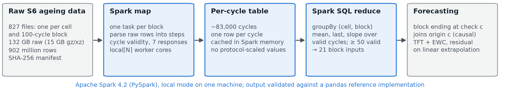

# Continual Learning for Heterogeneous Second-Life EV Batteries

**Course**: 21CSC314P – Big Data Essentials (Report Review 1)  
**Faculty**: Dr. Banu Priya Prathaban  
**Team**:
- Darshan D – RA2411028010056
- Sohan Sandeep Krishnan – RA2411028010014
- Tarun Sitaraman – RA2411028010038

This repository is both a course project and the code behind an IEEE paper. Every number in it is meant to be traceable to code and a commit. The sections below explain the project from first principles: the problem, the data, every pipeline stage, the models, how they are evaluated, what Apache Spark does, and what we found.

## Contents

1. [The project in one page](#1-the-project-in-one-page)
2. [Background: the ideas you need](#2-background-the-ideas-you-need)
3. [The data](#3-the-data)
4. [End-to-end pipeline](#4-end-to-end-pipeline)
5. [Components, one by one](#5-components-one-by-one)
6. [Apache Spark: what it does here and how](#6-apache-spark-what-it-does-here-and-how)
7. [Evaluation protocols and statistics](#7-evaluation-protocols-and-statistics)
8. [Results](#8-results)
9. [Limitations and honest claims](#9-limitations-and-honest-claims)
10. [Repository map](#10-repository-map)
11. [Running things](#11-running-things)
12. [Literature review](#12-literature-review-10-key-papers)
13. [Legacy data dictionary](#13-legacy-data-dictionary)
14. [References](#14-references)

**Where to look next:** `docs/WORK_PLAN.md` (what is still to do), `docs/D24_NIGHT_RUN.md` (the D24 run: RC-TFT and literature baselines), `docs/RESULTS.md` (all findings with provenance), `docs/DECISIONS.md` (every protocol decision, D1–D23), `docs/DATA_REPORT.md` (data audit), `docs/EXTERNAL_DATA.md` (sources, licences, hashes), `docs/SPARK_DEMO.md` (Spark demo script), `paper/` (the manuscript).

---

## 1. The project in one page

**Question.** Retired electric-vehicle batteries still hold useful capacity and can serve a second life, for example in stationary storage. Before reuse we must know how healthy each one is and how fast it will keep ageing. Batteries differ in history and duty, and new groups keep arriving. Can **one model keep learning from each new battery group without forgetting the earlier ones**, and are its forecasts good enough to support a reuse decision?

**What we built.**

| Layer | What it is |
|---|---|
| Data | Public battery-ageing datasets, downloaded from their original archives and verified file by file (SHA-256 / CRC-32 manifests) |
| Task | **Forecast the State of Health (SOH)** of a cell at its next 1–6 capacity checks |
| Models | Baselines (persistence, linear extrapolation, ridge, gradient boosting), an MLP, and the proposed **Temporal Fusion Transformer (TFT) with Elastic Weight Consolidation (EWC)** |
| Learning setting | **Continual learning**: groups arrive one at a time; we measure accuracy, forgetting and transfer |
| Big-data component | An **Apache Spark** job that reduces about 132 GB (902 million rows) of raw ageing data to block-level features |
| Reuse | Forecast SOH is mapped to four fade classes (C0–C3) |
| Tooling | 150 tests, pre-registered protocols, a live data-platform web page, and the paper |

**Headline findings** (details and caveats in [Section 8](#8-results)):

1. Simple methods are hard to beat. On the large LFP dataset no method beats **linear extrapolation** of the recent fade rate (0.343 pp RMSE); the best learned model is only level with it.
2. A TFT that learns only the **residual** on top of linear extrapolation is the best learned model and is practically equivalent to extrapolation at horizons 1–3.
3. **EWC reduces forgetting** of the residual TFT at longer horizons (replicated across two seed sets), but forgetting only matters when the groups differ a lot.
4. Extra diagnostic features (EIS, pulse resistance, incremental-capacity peaks) describe the *current* SOH well but add little for the *next change*.
5. Some earlier significance results did not survive a re-run in a different environment, and the repository says so.

---

## 2. Background: the ideas you need

| Term | Meaning in this project |
|---|---|
| **Cell / battery group** | One physical cell (S1, S6) or one usage condition (S6 test case). Groups are the unit we never mix across train and test. |
| **Cycle** | One charge–discharge. Cycling data are measured every second or so, so there are many rows per cycle. |
| **RPT (Reference Performance Test)** | A slow, standardised capacity test done every few weeks. Its discharge capacity is the trusted health measurement. In dataset S6 the same idea is called a *check*. |
| **Capacity (Ah)** | Charge the cell can deliver at a slow rate. It falls as the cell ages. |
| **SOH (State of Health)** | `SOH_Percent = Capacity_Ah / Reference_Capacity_Ah × 100`, where the reference is the cell's **first valid RPT**, not its nominal rating. So 100 % means "as healthy as when we first measured", and our SOH is *relative*. |
| **pp (percentage points)** | Unit of all errors. An RMSE of 0.4 pp means forecasts are off by about 0.4 SOH points. |
| **Forecasting task (D18)** | From origin RPT *k*, predict ΔSOH to RPT *k*+*h*, for *h* = 1–3 (and up to 6 in D23). |
| **Persistence** | Predict "no change". The baseline every forecaster must beat. |
| **Continual learning** | Train on tasks in sequence and never revisit old data (except by explicit replay). |
| **Catastrophic forgetting** | After learning a new task the model gets worse on an old one. |
| **EWC (Elastic Weight Consolidation)** | A penalty that stops the weights that mattered for earlier tasks from moving: `(λ/2) Σ_k Σ_i F_k,i (θ_i − θ*_k,i)²`, where `F` is the Fisher information of each finished task. |
| **TFT (Temporal Fusion Transformer)** | A sequence model (Lim et al., 2021) with gated residual networks, variable selection, an LSTM encoder and interpretable attention. Here its input is the last four checks of one cell. |
| **Adaptation / retention / backward transfer** | Error on the newest task; error on older tasks after later learning; how learning a later task changes old-task error. |
| **Reuse classes (D10)** | From fade `F = 100 − SOH`: **C0** < 5 pp, **C1** 5–10, **C2** 10–20, **C3** ≥ 20 pp. They describe capacity change, not suitability for an application. |

---

## 3. The data

### 3.1 Sources

All data are public and used under their licences. `docs/EXTERNAL_DATA.md` records citation, licence, version, hashes and verification for each.

| ID | Dataset | Chemistry / size | Role in this project |
|---|---|---|---|
| **S1** | Stanford second-life dataset (Moy et al., 2024), OSF `8jnr5`, CC BY 4.0 | 6 LG M50T NMC cells on grid duty cycles; 111 RPTs | Dataset 1 of the forecasting study; second-life stream of 6 cells |
| **S2** | Project handover CSVs (processed S1) | 7 CSV files | Starting point; superseded labels; notebooks 01–10 |
| **S6** | Wheeler et al., 2025, Recherche Data Gouv `10.57745/OLBXKT`, CC BY 4.0 | 20 A123 LFP cells, 7 usage conditions, aged at 50 °C; 847 checks (843 labelled); 2,409 forecasting samples; 827 ageing files, about 132 GB raw | Dataset 2: the main continual stream, and the Spark workload |
| **S7–S9** | Luh and Blank 2024 (KIT), Wang et al. 2024 (XJTU), Zhu et al. 2022 (Tongji) | 228 + 55 + 130 first-life cells; 369 cells and 36,711 samples after filtering | First-life **pretraining pool** (protocol P3) |

Not used: S3 (first-life data of the S1 cells), S4 (synthetic duty-cycle profiles, cited only) and S5 (Relyion data, no licence). The two main datasets are never pooled, so no cross-chemistry transfer is claimed.

**What "heterogeneous" means here.** In S1 the cells are one cell type that differs in first-life history and second-life duty cycle. In S6 the seven usage conditions differ in depth of discharge and related settings. Different chemistries and manufacturers motivate the work but are not present within one dataset.

### 3.2 What the data look like

**Handover CSVs (S2, in `data/`, git-ignored).** These feed the superseded current-SOH notebooks 01–09.

| File | Rows | Content |
|---|---|---|
| `cleaned_battery_data.csv` | 223,973 | Point-level cycling data (voltage, current, capacity, energy, temperature) |
| `final_battery_cycling_features.csv` | 223,925 | Cycle-level features, 18 model inputs plus identifiers |
| `final_ml_dataset.csv` | 609 | All cycles with the most recent RPT attached; SOH missing before the first RPT |
| `ml_training_dataset.csv` | 582 | The SOH-labelled subset |
| `final_battery_health_dataset.csv` | 111 | RPT capacity and SOH per battery |
| `rpt_capacity_data.csv`, `DATA_DICTIONARY.csv` | 337, 27 | Extracted RPT capacities; column definitions |

The six S1 batteries are `g1, v4, v5, w8, w9, w10`, with 16–19 RPTs each. Their relative SOH stays between about 95 % and 100 %: these cells fade slowly, which is why persistence is so hard to beat on S1.

**Tables built by this repository (also in `data/`).**

| File | One row per | Content |
|---|---|---|
| `rpt_health_c20.csv` | S1 (battery, RPT) | **C/20 capacity labels** (decision D17), pulses excluded |
| `diagnostic_features.csv` | S1 (battery, RPT) | Charge in voltage windows, pulse resistance (0.1/1/8 s), incremental-capacity peaks, EIS resistances |
| `wheeler_checks.csv` | S6 (cell, check) | C/25 capacity, C/3 capacity, incremental-capacity features, authors' values for cross-checking |
| `s6_ageing_cycles.csv` | S6 ageing cycle (82,529) | Measured responses per cycle |
| `s6_ageing_blocks*.csv` | S6 (cell, 100-cycle block), 827 | Block-level inputs; `_spark` files come from the Spark job, the others from pandas |
| `pool_s7/s8/s9_checks.csv` | pool check | First-life capacity checks with SOH |

**Raw archives** (`data/raw/`, about 25 GB, git-ignored) keep the original downloads. Cached conversions are in `data/cache/`.

### 3.3 What matters most about this data

1. **SOH is relative.** It is measured against the first RPT, which in S1 is already an aged state. Do not compare these numbers directly with literature values that use nominal capacity.
2. **Labels repeat between checks.** SOH is a step function: it only changes at an RPT. So a model that "estimates current SOH" can score well by copying the last label. That is exactly what happened with the original task, so we reframed it as forecasting (D16).
3. **Temporal alignment.** A cycle may only use the most recent RPT on or before its date. Same-day RPTs stored as a date only are read as midnight (D3).
4. **Leakage via test currents.** Protocol currents are set from the previous capacity (for example, 0.9998 × the previous capacity), so they would leak the label. They are never inputs (D14).
5. **Label correction.** The handover capacity included pulse charge, shifting some labels by up to 0.09 pp. We rebuilt labels from the raw C/20 discharge (D17). The handover's own pulse-inclusive capacities were reproduced exactly from the raw files (all 112 RPT capacity rows, i.e. 111 RPTs; g1's RPT 1 spans two files), and our S6 parser reproduces the authors' C/3 capacity on all 843 checks.
6. **Groups stay separate.** Splits are chronological within each cell, purged, and never shuffled. Results are reported per group.
7. **Missing temperature is not invented.** Missingness is flagged, imputation is fit on training data only, and robustness is tested by removing values, never by adding data (D13).
8. **No synthetic data in results.** Synthetic data may test code paths only and live outside the repository.

---

## 4. End-to-end pipeline

```
 PUBLIC ARCHIVES (OSF, Recherche Data Gouv, Zenodo, KIT RADAR)
        │  scripts/fetch_*.py   resumable, CRC-32 / SHA-256 / MD5 verified
        ▼
 data/raw/…  (about 25 GB; the S6 ageing files are about 132 GB uncompressed)
        │
        ├─ S1 raw RPT + EIS ───► build_diagnostic_features.py ─► rpt_health_c20.csv, diagnostic_features.csv
        ├─ S6 check files ─────► build_wheeler_features.py ────► wheeler_checks.csv
        ├─ S7–S9 pool ─────────► build_pool_tables.py ─────────► pool_s*_checks.csv
        └─ S6 ageing blocks ───► spark_ageing_features.py (PySpark) ─► s6_ageing_blocks_spark.csv
        ▼
 FORECASTING SAMPLES        src/forecasting.py, wheeler.py, pool.py
   origin check k → ΔSOH at k+h; purged chronological splits; no protocol currents
        ▼
 MODELS                     baselines · MLP · TFT      src/models/, src/continual_learning.py
        ▼
 CONTINUAL PROTOCOLS        P1 stream · P2 leave-one-group-out · P3 pretrain then stream
        ▼
 EVALUATION                 RMSE, forgetting, backward transfer, Wilcoxon + Holm, bootstrap CIs, reuse classes
        ▼
 results/*.json  ─►  make_results_tables.py, make_d21_figures.py  ─►  docs/RESULTS.md, paper/
        ▼
 Paper (paper/)   +   Live data platform (scripts/platform_server.py)
```

The workflow of the original handover (raw Excel → cycling data → RPT capacities → SOH → temporal alignment → `ml_training_dataset.csv`) still exists and is documented in notebooks 01–09, but it feeds the **superseded** current-SOH task. Forecasting (D16–D23) starts from the raw archives.

---

## 5. Components, one by one

### 5.1 Data acquisition and verification (`scripts/fetch_*.py`, `verify_external_data.py`)
Fetchers resume per file and reuse an on-disk file only if its size and CRC-32 match the archive index. Every file's SHA-256 goes into a manifest in `docs/external_data/metadata/`. On Windows, use Mozilla's certificate bundle (`certifi`) instead of disabling TLS verification. Decision D15: the team owns the pipeline from the raw archive.

### 5.2 Label and feature building
- **S1 labels and diagnostics** (`src/raw_diagnostics.py`, `src/diagnostic_features.py`): reads raw RPT and EIS spreadsheets (cached as pickle files in `data/cache/`), extracts the C/20 capacity, charge in voltage windows, pulse resistance, incremental-capacity (dQ/dV) peak positions and heights, and EIS R0, arc resistance and impedance at fixed frequencies. Selection rules are fixed in code and every application is logged (`diagnostic_selection_log.csv`).
- **S6 checks** (`src/wheeler.py`): reads each check file, extracts C/25 and C/3 capacity and IC features, and compares them with the authors' values.
- **Pool** (`src/pool.py`): harmonises S7–S9 into the same sample format.
- **Ageing cycles** (`src/ageing.py`): per-cycle measured responses; see [Section 6](#6-apache-spark-what-it-does-here-and-how).

### 5.3 Forecasting samples (`src/forecasting.py`, D18)
A sample is (cell, origin check *k*, horizon *h*). Inputs known at the origin: SOH history, static descriptors, planned usage, calendar time (days between checks), and for the feature set F1 the diagnostic features. The target is SOH(*k*+*h*) − SOH(*k*). Splits are per cell: train ≤ 60 %, validation 60–80 %, test ≥ 80 % of the timeline, purged so that no target window crosses a boundary. Hyperparameters are tuned on validation data only (D11).

### 5.4 Baselines
| Method | Idea |
|---|---|
| Persistence | ΔSOH = 0 |
| Linear extrapolation | Continue the recent fade rate |
| Ridge | Linear model on the inputs (usage only, F0, F1 variants) |
| Gradient boosting | Histogram boosting on the shared inputs |

### 5.5 Neural models and continual-learning strategies
- **MLP backbone** (`src/models/baseline_dnn.py`): a small feed-forward network with train-fitted standardisation and explicit missing indicators.
- **TFT backbone** (`src/models/tft_continual.py`): gated residual networks, variable selection, LSTM encoder, interpretable causal attention. Input: a window of the previous four checks of the same cell, values plus missing indicators plus a padding flag. No battery ID is an input, so every method stays task-agnostic.
- **Strategies** (`src/continual_learning.py`). The D18/D20 benchmarks (notebooks 12–13, `CL_METHODS`) run fine-tuning and EWC on both backbones, and replay on the MLP only; joint training gives the upper bound for each backbone. The later D21–D23 runs compare fine-tuning and EWC only:

| Strategy | What it does |
|---|---|
| Fine-tuning | Train on the new task only (the forgetting baseline) |
| Replay | Keep a small buffer of old samples per task |
| **EWC** | Multi-penalty EWC with a diagonal Fisher per finished task |
| LwF | Distillation from the previous model (implemented and tested; run only in the superseded notebooks 06–07, not in the forecasting benchmarks) |
| Joint | Train on all tasks at once (the upper bound, not a continual method) |

- **Residual formulation (D23).** The best-performing variant predicts only the *correction* to linear extrapolation instead of ΔSOH directly. This is what made the TFT competitive.

### 5.6 Reuse assessment (`src/reuse.py`, `docs/REUSE_CATEGORIES.md`)
Forecast SOH is thresholded into C0–C3 using the same rule as measured SOH, rather than training a separate classifier. We report accuracy, macro-F1, linear-weighted kappa and confusion matrices. On S1 all samples stay in C0 and on S6 P1 all test periods are in C3, so classes can only be evaluated meaningfully in P2. The multi-task reuse head originally planned was **not** implemented; its empty stub was removed (12 Oct 2026).

### 5.7 Robustness and audits
`src/robustness.py` tests missing temperature by removal (D13). `scripts/audit_data.py` writes `results/data_audit.json`. `docs/DATA_REPORT.md` records how the delivered data differ from the handover description.

### 5.8 Notebooks
| Notebook | Purpose | Status |
|---|---|---|
| 01–03 | Ingestion, EDA, feature engineering | Current-SOH pipeline (superseded task) |
| 04–05 | Baselines, reference models | Superseded; showed persistence wins |
| 06–09 | Continual learning, TFT + EWC, reuse, missing temperature | Superseded task, kept for the record |
| 10–11 | Health indicators, diagnostic features | Feeds D16 |
| **12** | **S1 forecasting benchmark** (about 15 min on one CPU thread) | Current |
| **13** | **S6 forecasting benchmark** (about 1 h) | Current |

Notebooks 05–09 and 13 accept `EXPERIMENT_PROFILE=smoke` for a fast code check; only the default `paper` profile gives reportable numbers.

### 5.9 Live data platform (`scripts/platform_server.py`)
A local web server (default `http://localhost:8050`) that rebuilds a single page whenever a results file, table, manifest or Spark snapshot changes. Tabs: Overview, Datasets (catalogue and lineage), Tables, Raw files, Pipelines, Runs, Results, Spark run, Ageing explorer and Paper. Tables, Raw files, Results and Paper form a read-only **data browser** over every table, raw S6 file preview, results JSON and paper figure. A status bar shows running Spark jobs, the History Server and pipeline scripts. It serves only catalogued files, checks the `Host` header against DNS rebinding, and cannot change anything. `--lan` serves it on the local network. A static snapshot is `docs/spark_dashboard.html`.

### 5.10 Paper (`paper/`)
IEEE conference paper (8 pages). Tables and figures are generated from committed results files: `scripts/make_results_tables.py` writes the D18/D20 tables and refuses results written from a dirty tree; `scripts/make_d21_figures.py` draws the D21/D23 figures. The D21–D23 sections of `docs/RESULTS.md` are written by hand from their results files.

---

## 6. Apache Spark: what it does here and how

### 6.1 Why Spark
The S6 between-check ageing data (decision D22) is the project's real big-data workload: **827 CSV files** (one per cell and 100-cycle block), about **132 GB raw** (about 15 GB as stored locally, 23 GB as downloaded zips), **901,974,259 data rows** (counted by `scripts/count_s6_ageing_rows.py`; `results/s6_ageing_row_count.json`). Pandas on one file works but is slow and awkward to scale and validate. Each file is independent, which is exactly the shape of a map-reduce job.

### 6.2 What the job computes
`scripts/spark_ageing_features.py` turns the raw rows into **21 block-level ageing inputs**:

1. **Map.** One Spark task per block reads the raw rows and extracts, for each ageing cycle, the *measured responses*: end-of-charge and end-of-discharge voltage, constant-voltage (CV) hold time and final current, voltage relaxation after charge and after discharge, and internal resistance where recorded (S6 never records it, so its 3 inputs are always missing). It also sets a validity flag. The parsing function is `src/ageing.py::cycle_responses`, a plain tested Python function.
2. **Cache.** The per-cycle table (82,529 cycles) is cached in Spark memory.
3. **Reduce.** Spark SQL groups valid cycles by (cell, block) and computes the mean, the last value and the least-squares slope against cycle number (covariance / variance). A block needs at least 50 valid cycles.
4. **Validate.** The output is compared with the pandas implementation (`build_s6_ageing_features.py`). `results/d22_spark_validation.json` records that all 827 blocks match under |Spark − pandas| ≤ 1e-9·|pandas| + 1e-12 (largest absolute difference about 2e-13). A purely relative 1e-9 criterion, stated first, failed only on a slope that is zero up to rounding (`results/d22_spark_validation_strict_relative.json`).

Protocol-scaled quantities (discharged charge, setpoint currents) are **never** used as inputs, because in most cases they encode the previous check's capacity (D22 leakage rules). A causality check found no block ending after a valid check; one block (cell 2a, cycle 100) ends after an invalid check, which is never a forecast origin.

### 6.3 How it is implemented
- **PySpark 4.2.0** in **local mode** (`local[N]` worker threads) on one Windows PC. There is **no cluster**; say so when presenting.
- Needs **Java 17 or 21**. The event log and History Server also need Hadoop's Windows helpers (`winutils.exe`, `hadoop.dll`), checked against published hashes (`docs/SPARK_DEMO.md`).
- Spark runs as `local[N,4]`, allowing four attempts per task, because a Python worker can occasionally be slow to start on Windows. Tasks are deterministic, so a retry cannot change results.
- The full run took 19.6 min on the first run (6 Oct 2026) and 43 min on a loaded machine; the block inputs were identical (largest difference 0.0).

### 6.4 What Spark's own UI shows
| View | What to look at |
|---|---|
| Jobs | The `MAP: parse … ageing blocks` job, then the `REDUCE: Spark SQL aggregation` jobs |
| Stages | One task per block; a shuffle between the aggregation stages |
| Storage / Executors | The cached per-cycle table; worker cores |
| SQL | Physical plan: scan → in-memory table → hash aggregate → exchange → hash aggregate |

Screenshots are in `docs/figures/spark/`. The **History Server** (`scripts/spark_history_server.ps1`, `http://localhost:18080`) replays a finished run from `data/spark-events`.



### 6.5 What came out of it
The 21 ageing inputs were used as feature set F2. They track health within a cell but mostly its *level*, which the SOH history already gives (an interpretation, not a tested claim). With 135–225 training samples per task they add variance: **residual TFT + EWC got 0.14–0.19 pp worse** (replicated). So the Spark pipeline is validated and reusable, but the features did not improve the forecast. This is reported as a negative result.

Run it: `python scripts/spark_ageing_features.py --cores 6 --ui 900` and open `http://localhost:4040`. The demo script is in `docs/SPARK_DEMO.md`.

---

## 7. Evaluation protocols and statistics

| Protocol | Setting |
|---|---|
| **P1** | A continual **stream** of tasks (S1: cells; S6: test cases), 10 task orders × 5 seeds; from D21 on, also replicate seeds 5–9 |
| **P2** | **Leave one group out**: train on the others, test on the held-out group |
| **P3** | **Pretrain** on the first-life pool S7–S9, then learn the S6 stream |
| Joint | All tasks at once; an upper bound |

**Metrics.** RMSE of SOH(*k*+*h*) in pp (MAE secondary); skill = 1 − RMSE / RMSE_persistence; **forgetting** (worst earlier error vs final); **backward transfer**; adaptation (newest task); reuse-class accuracy and macro-F1.

**Statistics.** Paired Wilcoxon tests with Holm correction, rank-biserial effect sizes, bootstrap 95 % CIs. From D21, a result counts as **replicated** only if p_Holm < 0.05 in both seed sets, with the same sign and |difference| ≥ 0.05 pp; |difference| < 0.05 pp in both is **practically equivalent**.

**Pre-registration.** Protocols D18, D20, D21, D22 and D23 were written into `docs/DECISIONS.md` before the runs they govern. Deviations and post-hoc analyses are labelled as such.

---

## 8. Results

Full results, provenance and generated tables: `docs/RESULTS.md`.

**Final average test RMSE (pp) on S6, experiment D23 E1** (horizons 1–3, D21 shared inputs, same runner and tuning for every method). Learned methods: mean over 50 runs, main / replicate seeds. Baselines: single deterministic fits. Lower is better.

| Method | RMSE (pp) |
|---|---|
| TFT + EWC, residual | 0.339 / 0.314 |
| Linear extrapolation | 0.343 |
| TFT fine-tuning, residual | 0.347 / 0.337 |
| MLP + EWC, residual | 0.374 / 0.366 |
| MLP fine-tuning, direct | 0.413 / 0.351 |
| TFT fine-tuning, direct | 0.424 / 0.444 |
| Gradient boosting | 0.451 |
| TFT + EWC, direct | 0.504 / 0.487 |
| Persistence | 1.644 |

Residual TFT + EWC and linear extrapolation are practically equivalent under the registered test. With the D20 inputs (including the 17 diagnostics), gradient boosting reaches 0.372 pp.

**What we learned**

1. **Diagnostics describe the present, not the next change.** IC peak near 4.07 V, pulse and EIS resistances track current SOH (|ρ| 0.83–0.97 within cells) but are weakly associated with the next ΔSOH (median |ρ| ≤ 0.3 for most features; exceptions are EIS Z′ at 3.26 V and q_3.63_3.26, which may follow the temperature schedule).
2. **Best methods beat persistence on both datasets**, but not every method does. On S1 the best is a ridge on planned usage alone (0.450 pp); on S6, linear extrapolation.
3. **Forgetting depends on task heterogeneity**: negligible across the S1 cells (0.016–0.040 pp), substantial across S6 usage conditions (0.18–0.46 pp).
4. **Calendar time is a key input.** On S6, fade per 100 cycles rises with the days those cycles took (within-cell ρ = 0.64, positive in 20/20 cells). Switching from the D20 F1 inputs to the D21 shared inputs improved the TFT by 0.37–0.47 pp; dropping the 17 diagnostics (0.17–0.35 pp) and adding calendar time (0.19–0.31 pp) each replicate on their own (post hoc).
5. **Pretraining on first-life data did not help** S6 forecasts (P3). The stream did not degrade pool error either.
6. **Residual learning makes the TFT competitive** (0.17 pp better than direct in horizons 1–3, 0.24–0.30 pp in horizons 1–6, replicated). The registered goal of *beating* linear extrapolation was **not** reached.
7. **EWC lowers forgetting of the residual TFT** at horizons 1–6 (from 0.28 / 0.22 pp to 0.09 pp, replicated); its effect on final error is not replicated.
8. **Reuse classes** are only informative in P2 on S6: forecast classes agree with measured classes for 96–97 % of samples (macro-F1 0.87–0.88), against 85 % (0.64) for persistence.
9. **Reproducibility check.** Re-running in a different environment kept all baselines identical, but several TFT significance statements on S1 and S6 flipped across p = 0.05 (for example the S6 EWC-vs-fine-tuning error difference moved from p_Holm = 0.005 to 0.060). Those comparisons are reported as not robust. See `docs/RESULTS.md`.

Figures are in `results/figures/`, `paper/figures/` and `docs/figures/spark/`.

---

## 9. Limitations and honest claims

- **The task changed after seeing data.** We moved from current-SOH estimation to forecasting once persistence beat the first baselines (D16). The forecasting protocol was fixed before any forecasting model was trained.
- **Small datasets.** S1 has 6 cells and S6 has 2–3 cells per condition, so leave-one-group-out tests have little power.
- **Relative SOH.** Do not compare directly with literature numbers on different datasets or SOH definitions.
- **S6 "second life".** S6 is aged at 50 °C and "second life" means continued ageing below 80 % SOH under the same protocol, not a repurposed duty cycle.
- **Conditional forecasts.** Forecasts assume the planned usage is known.
- **Spark is single-machine.** It demonstrates the map-reduce design and validates against pandas; it is not a cluster benchmark.
- **Some significance statements are not robust** to the numerical environment (Section 8, item 9).
- **Novelty.** The contribution is an integrated, battery-focused evaluation of forecasting, continual learning and reuse classes. TFT, EWC and reuse classification are not individually novel.
- **Open team items:** the Hugging Face mirror's dataset card, permission to use the Relyion data, affiliations and author order, and the repository licence.

---

## 10. Repository map

```
README.md           this file
CLAUDE.md, AGENTS.md  project rules (reproducibility, no data in Git, invariants)
PLAN_OF_ACTION.md   original plan;  docs/RESEARCH_PLAN.md  revised research plan
data/               datasets (git-ignored) + data/README.md (how to obtain them)
docs/               RESULTS, DECISIONS (D1–D23), DATA_REPORT, EXTERNAL_DATA, REUSE_CATEGORIES, SPARK_DEMO
notebooks/          01–13 (12 and 13 are the current forecasting benchmarks)
src/                library code: data_pipeline, raw_diagnostics, diagnostic_features, health_indicators,
                    forecasting, wheeler, pool, ageing, protocols, experiments, continual_learning,
                    evaluation, reuse, robustness, p3; models/ (MLP, TFT)
scripts/            fetchers, feature builders, experiment runners (run_p3, run_d23, run_ablation_a1),
                    Spark job, platform server, figure and table generators
tests/              150 pytest tests
results/            committed result JSON files, generated tables (results/tables) and figures
paper/              IEEE manuscript, generated tables and figures
```

Conventions (from `AGENTS.md` and `CLAUDE.md`): datasets and checkpoints stay out of Git; battery-group identity and temporal order are preserved in evaluation; missing temperature is documented, never silently filled; continual-learning evaluation always reports adaptation **and** retention; every reported number traces to code and a clean commit.

---

## 11. Running things

```bash
pip install -r requirements.txt          # Python 3.11; Java 17/21 is needed only for Spark
export DATA_ROOT=data                    # where the CSVs live (default: data/)

python -m pytest                         # 150 tests

# Fetch and build data (see data/README.md for sizes, hashes and Windows TLS notes)
python scripts/fetch_osf_diagnostics.py && python scripts/build_diagnostic_features.py
python scripts/fetch_wheeler_characterisation.py && python scripts/build_wheeler_features.py

# Experiments
jupyter nbconvert --to notebook --execute notebooks/12_forecasting.ipynb --output-dir /tmp/executed
jupyter nbconvert --to notebook --execute notebooks/13_wheeler_forecasting.ipynb --output-dir /tmp/executed

# Spark job and live platform
python scripts/spark_ageing_features.py --cores 6 --ui 900     # Spark UI at http://localhost:4040
python scripts/platform_server.py                               # data platform at http://localhost:8050
```

The handover CSVs are not in Git. A mirror is at `https://huggingface.co/datasets/TarunSitaraman/second-life-ev-battery-datasets`; `data/README.md` explains how to provide them.

**Data source and licence.** The S1 data are the public Stanford second-life dataset (six LG Chem INR21700-M50T cells), CC BY 4.0: K. Moy, M. A. Khan, S. Fasolato, G. Pozzato, A. Allam and S. Onori, "Second-life lithium-ion battery aging dataset based on grid storage cycling," *Data in Brief*, vol. 57, 111046, 2024, doi:10.1016/j.dib.2024.111046; dataset doi:10.17605/OSF.IO/8JNR5 (version 2). The handover CSVs are a processed subset and are not endorsed by the original authors. Other sources and their licences are in `docs/EXTERNAL_DATA.md`.

---

## 12. Literature review (10 Key Papers)

Bibliographic data match `paper/references.bib` (checked against Crossref). For refs 3, 6, 7 and 9 no open abstract could be read, so only what their titles state is given.

| # | Paper (Year) | Methodology | Main Finding | Main Challenge |
|---|-------------|-------------|--------------|----------------|
| 1 | Braco (2022) | Partial-charge / real-profile SOH | RMSE 0.6–0.8%; reduced testing time | Quality depends on profile/conditions |
| 2 | Braco (2022) | Health-indicator selection (58 indicators) | Best HI: 0.2% RMSE at repurposing; partial-charge useful in second-life | Indicators change with ageing |
| 3 | Faraji-Niri (2023) | EIS + machine learning | Accelerated SOH estimation from EIS tests (title only; abstract not verified) | EIS depends on measurement conditions |
| 4 | Takahashi (2023) | Features + bagged GPR | Mean RMSE <1.48% worst-case | Depends on measurable feature quality |
| 5 | Cui (2024) | Online ML + clustering (15+ months testing) | MAPE <2.3%; long-duration second-life data | Limited experimental population; resource-intensive |
| 6 | Vignesh (2024) | Review of second-life SOH estimation methods | Review and challenges (title only; abstract not verified) | Review-level; no new model |
| 7 | Lee (2024) | Bilevel-optimised continual learning | Capacity-degradation prediction (title only; abstract not verified) | Adaptation vs retention trade-off |
| 8 | Yao (2025) | PNN + TCN continual learning (3 public datasets) | Strong estimation across diverse batteries; reduces need for multiple single-task models | Focuses on SOC, not SOH/reuse |
| 9 | Li (2025) | Domain generalisation | Domain-generalised second-life SOH estimation (title only; abstract not verified) | Not continual learning |
| 10 | Meskine (2026) | BiLSTM/TCN + probabilistic model | Reliability calibration improvements; uncertainty-aware SOH | Sparse/noisy measurements; unseen-cell generalization |

### 12.1 Literature Survey Summary
Key cross-paper themes:
1. **Battery heterogeneity** — chemistry, manufacturer, capacity, ageing history, temperature, charging behaviour differ between groups
2. **Incomplete/sparse information** — first-life history often unavailable; noisy BMS-style signals
3. **Catastrophic forgetting** — learning new battery groups risks losing older knowledge
4. **SOH ≠ reuse assessment** — prediction accuracy alone doesn't dictate second-life application
5. **Accuracy vs computational cost** — complex adaptive methods must balance cost with performance

### 12.2 Research Gap
Literature progresses SOH estimation, fast screening, transfer learning, and degradation prediction **separately**. This project **integrates** three areas rarely combined:
- **Continual learning** methods for heterogeneous retired EV batteries
- **Adaptive health estimation** across progressive battery groups
- **Explicit reuse decision framework** with suitability categories

The novelty claim is therefore an integrated, battery-focused evaluation framework rather than a claim that TFT, EWC, or reuse classification is individually novel. The work measures the adaptation-retention trade-off, temporal health-label integrity, and practical reuse decisions together on heterogeneous second-life battery groups.

---

## 13. Legacy data dictionary

Columns of the handover files (`DATA_DICTIONARY.csv`), used by the superseded current-SOH notebooks 01–09.

| Column | Meaning | Unit / Example |
|--------|---------|----------------|
| `Battery_ID` | Battery identifier | g1, v4, v5, w8, w9, w10 |
| `Cycling_Test` | Cycling test identifier | Cycling_1, etc. |
| `Cycle_Index` | Battery cycle number | Integer |
| `Cycle_Date` | Timestamp of cycle data | Datetime |
| `Voltage_Mean` | Mean voltage during cycle | V |
| `Voltage_Min` | Minimum voltage during cycle | V |
| `Voltage_Max` | Maximum voltage during cycle | V |
| `Current_Mean` | Mean current during cycle | A |
| `Current_Min` | Minimum current during cycle | A |
| `Current_Max` | Maximum current during cycle | A |
| `Temperature_Mean` | Mean auxiliary temperature | °C |
| `Temperature_Min` | Minimum auxiliary temperature | °C |
| `Temperature_Max` | Maximum auxiliary temperature | °C |
| `Charge_Capacity_Max` | Maximum recorded charge capacity | Ah |
| `Discharge_Capacity_Max` | Maximum recorded discharge capacity | Ah |
| `Charge_Energy_Max` | Maximum recorded charge energy | Wh |
| `Discharge_Energy_Max` | Maximum recorded discharge energy | Wh |
| `Power_Mean` | Mean electrical power | W |
| `Capacity_Ratio_Mean` | Mean discharge/charge capacity ratio | Ratio |
| `Energy_Efficiency_Mean` | Mean discharge/charge energy ratio | Ratio |
| `Data_Points` | Number of raw observations in cycle | Count |
| `RPT` | Most recent RPT available at or before cycle | RPT_1, etc. |
| `RPT_Number` | Numerical RPT index | Integer |
| `Capacity_Ah` | RPT measured discharge capacity | Ah |
| `Reference_Capacity_Ah` | First observed RPT capacity for that battery | Ah |
| `SOH_Percent` | Capacity relative to first observed RPT capacity | % |
| `Days_Since_RPT` | Days from associated RPT date to cycle | Days |

---

## 14. References

[1] E. Braco, I. San Martín, P. Sanchis, A. Ursúa, and D.-I. Stroe, “State of health estimation of second-life lithium-ion batteries under real profile operation,” *Applied Energy*, vol. 326, 119992, 2022.

[2] E. Braco, I. San Martín, P. Sanchis, A. Ursúa, and D.-I. Stroe, “Health indicator selection for state of health estimation of second-life lithium-ion batteries under extended ageing,” *Journal of Energy Storage*, vol. 55, 105366, 2022.

[3] M. Faraji-Niri, M. Rashid, J. Sansom, M. Sheikh, D. Widanage, and J. Marco, “Accelerated state of health estimation of second life lithium-ion batteries via electrochemical impedance spectroscopy tests and machine learning techniques,” *Journal of Energy Storage*, vol. 58, 106295, 2023.

[4] A. Takahashi, A. Allam, and S. Onori, “Evaluating the feasibility of batteries for second-life applications using machine learning,” *iScience*, vol. 26, 106547, 2023.

[5] X. Cui, M. A. Khan, G. Pozzato, S. Singh, R. Sharma, and S. Onori, “Taking second-life batteries from exhausted to empowered using experiments, data analysis, and health estimation,” *Cell Reports Physical Science*, vol. 5, 101941, 2024.

[6] V. S, H. S. Che, J. Selvaraj, K. S. Tey, J. W. Lee, H. Shareef, and R. Errouissi, “State of Health (SoH) estimation methods for second life lithium-ion battery—Review and challenges,” *Applied Energy*, vol. 369, 123542, 2024.

[7] M. Lee, S. Kim, S. Kim, and J.-I. Choi, “Bilevel-optimized continual learning for predicting capacity degradation of lithium-ion batteries,” *Journal of Energy Storage*, vol. 86, 111187, 2024.

[8] J. Yao, B. Zheng, and J. Kowal, “Continual learning for online state of charge estimation across diverse lithium-ion batteries,” *Journal of Energy Storage*, vol. 117, 116086, 2025.

[9] X. Li, Y. Lin, S. Yang, and W. Zhang, “Intelligent domain-generalized second-life EV battery state-of-health estimation,” *Journal of Energy Storage*, vol. 140, 118989, 2025.

[10] S. Meskine, S. Al-Majeed, and H. El Asri, “Reliability Assessment of Second-Life EV Batteries Using Probabilistic Deep Learning Models for State-of-Health Prediction,” *World Electric Vehicle Journal*, vol. 17, 441, 2026.
